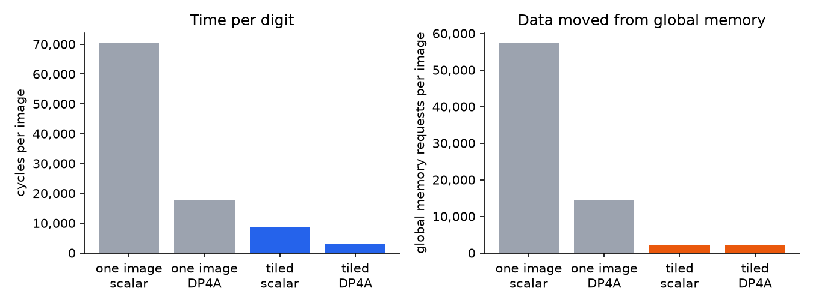
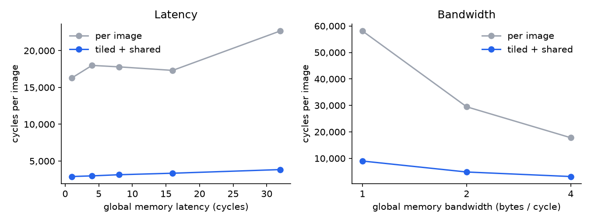
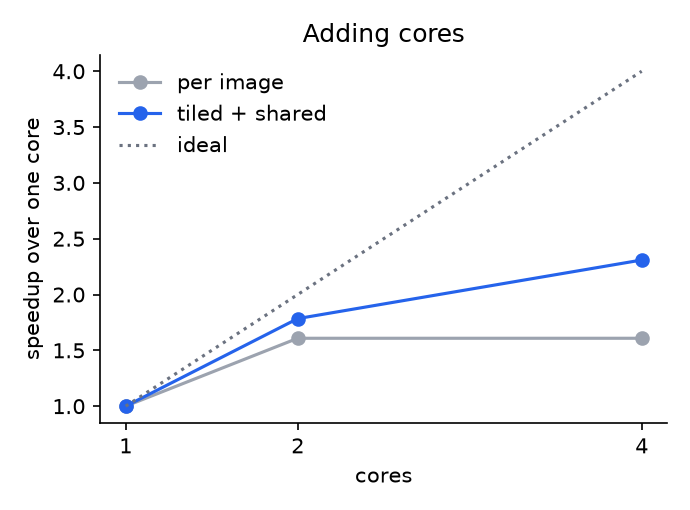
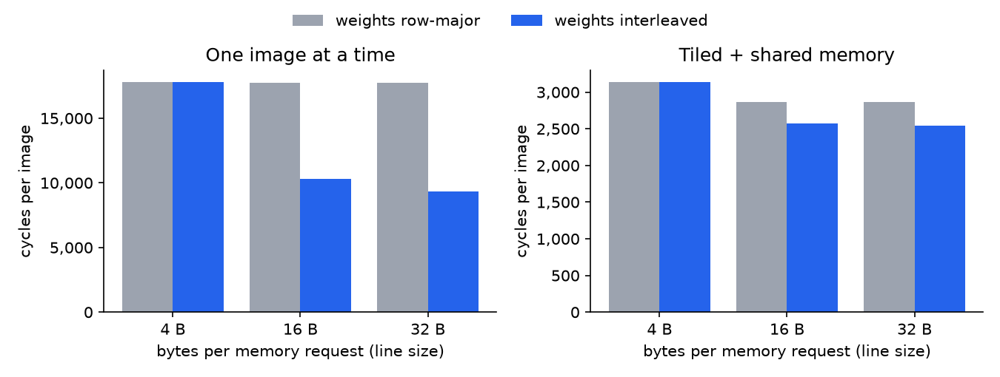
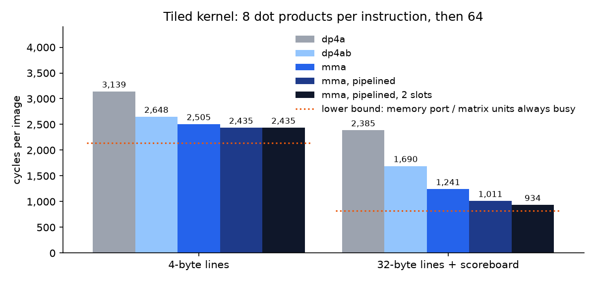

# Rosenblatt: a tiny GPU, from logic gates to handwritten digits

Rosenblatt is a small GPU designed from scratch: the hardware in Verilog, an
instruction set, an assembler, a reference emulator, a driver, a quantized
neural network that recognizes handwritten digits, builds for a real FPGA
board, and a profiling study that ends on an NVIDIA RTX 5080. It is named after
Frank Rosenblatt, whose 1958 Mark I Perceptron was a neural network built
directly in hardware.

This document is about the decisions: what was built, what each choice cost,
what the measurements showed, and why a commercial GPU is tens of thousands of
times faster on the same problem.

| | |
| --- | --- |
| Hardware | SIMT GPU, 2 cores x 8 lanes x 4 warps (parameterized), about 2,200 lines of Verilog |
| Software | ISA, assembler, emulator, runtime and 6 kernels; about 7,300 lines of Python including tests and tools |
| Network | 784-64-10 MLP, int8, 97.80% on the MNIST test set (float32: 97.77%) |
| Verified | every scenario bit-exact against the emulator on 5 hardware configurations; the full network over a simulated UART |
| Baseline tiled kernel | 3,139 cycles per digit (32-image batch, 256 KiB RTL simulation, DP4A): 125.6 µs at 25 MHz |
| Beyond the baseline | optional memory-system upgrades (11% more logic), a cross-lane dot product (4%) and a matrix unit (10%, with a second slot per warp under 1% more): with kernels written for them, one image 2.9x faster, tiled 3.4x |
| FPGA | ULX3S ECP5-85F: the full design occupies 53% of the logic, with 64 KiB global memory and two supported PCB pinouts. Not yet run on a physical board |
| RTX 5080 | the same network in 4.1 ns per digit (cuBLAS, tensor cores) |

## 1. The machine in one page

A kernel launch runs a grid of thread blocks; every thread runs the same
program on different data. Threads are grouped into **warps** of 8 that share
one program counter and execute in lockstep on a core's 8 lanes (SIMT, "single
instruction, multiple threads", the execution model of every NVIDIA GPU). A
core holds 4 warps and each cycle issues one instruction from whichever warp
is ready. While one warp waits for memory, the others compute.

```
   S0 schedule + fetch -> S1 decode + register read -> S2 execute -> S3 write back
```

Each core has 8 register files (16 registers x 4 warps x 32 bits), 8 ALUs
with an int8 dot-product instruction (DP4A), 4 KiB of shared memory in 8
banks, and a load/store unit for the global memory that all cores share.
Details: [architecture.md](architecture.md), [isa.md](isa.md).

## 2. Design decisions and what they cost

### Warps instead of forwarding

A conventional CPU pipeline lets the next instruction start before the previous
one has written its result, which needs hazard detection and forwarding
paths. Rosenblatt never issues two instructions from the same warp into
the pipeline at once, so neighbouring instructions cannot conflict: no
forwarding paths and no interlocks. (Global loads take far longer than the
pipeline; section 4 measures an optional scoreboard for them.) The cost is
single-warp speed: one warp gets at most one
instruction every three cycles. The core reaches full speed only with three or
more ready warps. That is the GPU bet in miniature: give up latency for one
thread, win throughput for many.

### Three register-file read ports

`mad` (rd += rs1 x rs2), `dp4a` and stores read three registers. FPGA RAMs have
one read port, so each lane stores its register file three times and writes
all copies. The alternative, two-operand instructions only, would cost an extra
instruction for every multiply-accumulate, the most common operation in a
neural network.

### Divergence the way Fermi did it

When threads of a warp disagree on a branch, something has to run both paths.
The options:

| Approach | Used by | Cost |
| --- | --- | --- |
| Predication only (no divergent branches) | early shader cores | the compiler must if-convert everything |
| Per-warp reconvergence stack (`ssy` / `sync`) | NVIDIA Fermi to Pascal | an 8-entry stack per warp |
| Per-thread program counters | NVIDIA Volta and later | a scheduler that tracks every thread |

Rosenblatt uses the stack. A divergent branch runs the fall-through threads
first and pushes the taken ones; `sync` switches to them or reconverges.
Correctness never depends on `ssy`/`sync` placement. Threads that split simply
stay split until they exit, so reconvergence only affects speed. That makes the
mechanism easy to verify. A random-program test generates nested if/else, loops
with per-thread trip counts and early returns, and checks the result against
running each thread on its own.

### Global memory: one line per request

Global memory accepts one request per cycle from the whole GPU, and a request
moves one aligned *line*: 4 bytes in the default build, or 8, 16 or 32 bytes
(`GMEM_LINE`). The load/store unit **coalesces**: lanes whose addresses fall
in the same line share one request. With 4-byte lines, 8 lanes reading 8
consecutive bytes cost 2 requests instead of 8, but 8 consecutive words still
cost 8. With 32-byte lines, like the sectors real GPUs fetch, they cost one.

Wide lines are cheap for loads and expensive for stores. On a load, each lane
picks its own word out of the returned line: an 8-to-1 multiplexer per lane.
A store needs the reverse. Every byte of the line chooses among all 8 lanes,
and when two lanes write the same byte the higher lane must win. Built that
way, the load/store unit for 32-byte lines was four times the size of the
4-byte one (7,218 against 1,855 LUTs, synthesized on its own), and the whole
GPU grew by 40%. Stores now coalesce only within one 32-bit word, as they did
before. That halved the unit (3,527 LUTs) and slowed the tiled kernel by 1%:
stores are a small part of its traffic, and with wide lines its memory port is
mostly idle. Section 4 measures what wide lines buy.

### Shared memory: banks, conflicts, and the price of a crossbar

Shared memory has 8 banks so 8 lanes can access it in one cycle. The routing
between lanes and banks turned out to be the most expensive block in the
design. The first version used priority muxes and variable-index writes. Yosys
turned those into wide shifters, and the result was **14,600 LUTs, more than
all eight ALUs together**. Two changes brought it to about 6,000:

1. writing the routing as one-hot AND-OR logic (each bank has exactly one
   "leader" lane, so no priority encoding is needed), and
2. letting stores write **one lane per bank per cycle**. Several lanes
   storing into the same word take turns, lowest lane first, so the highest lane
   lands last. That preserves the architectural rule that the highest lane wins,
   and removes a byte-merging network. The price is extra cycles for colliding
   stores, which well-written kernels do not do.

Bank conflicts are handled the way NVIDIA does it: the instruction is replayed
for the lanes that were not served.

### Loads block the warp, so the load/store unit must not

By default, a warp that issues a global load waits until the data arrives,
and other warps hide the wait. An optional register scoreboard (section 4)
lets it keep going until an instruction needs the loaded register. The first load/store unit handled one instruction
at a time and only took the next after all its data had returned. Profiling
showed the cost (section 4): the unit was busy 91% of the time while the
memory port behind it sat idle more than half the time. The redesigned unit sends one
instruction's requests and then accepts the next while up to four are still
waiting for data. This is memory-level parallelism, the reason real GPUs track
hundreds of outstanding misses.

A plausible-looking fix that failed: putting warps to sleep while the
load/store unit is busy, instead of letting them retry. It saves issue slots,
but a woken warp needs three cycles to come back down the pipeline, and the
unit sits idle meanwhile. Measured: 9% slower for the memory-bound kernel. The
hardware still has it as an option (`PARK`), off by default.

### A domain-specific instruction: DP4A

`dp4a rd, ra, rb` adds the four products of the signed bytes of `ra` and `rb`
to `rd`: four int8 multiply-adds in one instruction. NVIDIA added the same
instruction in Pascal (2016). It is also the idea behind MMX in 1997 (packed
integer arithmetic in a wide register), and behind today's tensor cores, which
are the same move scaled up. It cuts the instructions per digit almost 4x
(from 45,071 to 11,471 warp instructions for the one-image kernel) and needs
four 8x8 multipliers per lane. On the ECP5 those are four DSP blocks
per lane, which is why the smallest build uses a 16-bit multiplier for `mul`
to stay within the chip's 28 DSPs.

`dp4ab rd, ra, rb, lane` takes one more step toward a tensor core: every lane
takes `ra` from one lane of the warp. Eight in a row, one per lane, multiply
an 8x4 tile of int8 values by a 4x8 tile across the warp. A real tensor-core
instruction does that in one issue, which means writing several registers per
lane per instruction. Rosenblatt's register files have one write port, so the
tile takes eight issue slots. The hardware is one 8-to-1 multiplexer per core
(section 4 measures what it buys).

### A matrix unit beside the pipeline

`mma ra, rb` (optional, `ENABLE_MMA`) does those eight `dp4ab`s in one
instruction: it multiplies an 8x4 int8 tile (row j: lane j's `ra`) by a 4x8
one (column i: lane i's `rb`) and adds the product to an 8x8 tile of int32
accumulators. That is 64 results, eight per lane, and a lane's register file
can write one register per cycle. The options:

| Where the accumulators go | Cost |
| --- | --- |
| the register file, written over eight cycles | the write port is busy for eight cycles, and every other warp's results wait |
| the register file, with more write ports or wider registers | the files are already stored three times for three read ports; eight write ports multiply that again |
| somewhere else | instructions to clear the tile (`mmaz`) and to read it back (`mmar`) |

Rosenblatt keeps them somewhere else: a small LUT RAM per lane holds that
lane's column of every warp's tile. NVIDIA's data-center Blackwell GPUs
likewise keep tensor-core accumulators in a separate tensor memory. An `mma`
copies its operands from all eight lanes into a slot of its warp in the
matrix unit and then leaves the pipeline like an add. The unit computes one
row of the tile per cycle; the warp runs on, and its next `mma` waits only
if the warp's slots are all taken: one by default, two with `MMA_SLOTS=2`
(section 4).

The unit has no multipliers of its own. It borrows each lane's four `dp4a`
multipliers in every cycle in which the instruction in the execute stage is
not a `dp4a`. On the 85F the DSP blocks are the scarce resource (112 of 156
in use), and a second set of four per lane would not have fit. So `mma` adds
no arithmetic. It changes what keeps the multipliers busy. With `dp4ab` it is
the instruction stream, at one instruction per cycle at best and in the same
issue slots as the loads, address updates and branches. With `mma` it is a
unit that computes beside the pipeline while those instructions issue.
Section 4 measures the difference, and section 5 the cost: multiplexers and
LUT RAM, 10% more logic.

### Quantization without a multiplier

The network runs entirely in integers: int8 weights and activations, int32
accumulators. Rescaling a layer's int32 sums back to int8 normally takes a
multiply by a fixed-point factor. Rosenblatt chooses the hidden layer's scale as
a power of two times the product of the input and weight scales, so rescaling
is just `(acc + round) >> 10` followed by a clamp. That costs at most one bit of
activation range. Measured accuracy: float32 97.77%, int8 after post-training
quantization 97.74%, after three epochs of quantization-aware fine-tuning
97.80%. The bits were free.

### The host link has no retries

On the FPGA, the PC talks to the GPU over a UART with CRC-checked frames and
sequence numbers (`docs/serial.md`). The driver never retries: if a response
is lost, the write may or may not have happened, and silently repeating it
could double-apply it. Failures stop the connection and the board is reset.
Simple, and impossible to get subtly wrong.

## 3. How it was verified

The emulator (`sw/rosenblatt/emu.py`) defines what the hardware must do. It has
no timing, but it counts the same architectural events as the hardware's
performance counters: instructions, active lanes, coalesced requests,
shared-memory wavefronts, divergent branches. Every RTL test runs a scenario
on both and requires **identical outputs and identical counters**:

- straight-line random ALU programs over edge-case values;
- random nested divergence (if/else, per-thread loops, early returns),
  checked against a one-thread-at-a-time interpreter;
- every load/store width on global and shared memory, coalescing, bank
  conflicts, "highest lane wins" collisions, barriers;
- random sequences of global loads and the instructions that use them: as
  operands, store data, addresses of further loads and branch conditions,
  overwritten before their data arrives, and still in flight at a barrier or
  at the end of the kernel;
- random programs around the matrix unit: `mma`, `mmaz` and `mmar` among
  `dp4a`s (which hold the unit off the multipliers), loads still in flight,
  divergent regions in which only some lanes' tile columns change, and
  barriers, with all the warps of a core competing for the unit;
- vector add, naive and tiled matrix multiply, a tree reduction;
- the network three ways: one image at a time, batched and tiled (with every
  kernel variant, the matrix unit's included), and the full trained model,
  with both weight layouts;
- five hardware configurations: the default; a 1-core 4-lane build with a
  16-bit multiplier, no DP4A, a one-instruction load/store queue and the
  register scoreboard; a 3-core build with slow memory, 8-byte lines, a
  two-instruction queue, parked warps and a matrix unit with 4x4 tiles and
  four slots per warp; and the default configuration with 32-byte
  global-memory lines, the scoreboard and the matrix unit, with one slot per
  warp and with two.

The UART bridge is tested at the pin level (corrupted frames, glitches, bad
stop bits, ±1% baud error, stalled buses), and the production Python driver runs
the full network on the simulated GPU through the simulated UART pins. The
profiling study checks every one of the 10 output scores of every image it
measures against the NumPy reference.

## 4. Profiling: where the time goes

Every number in this section comes from cycle-accurate simulation of the
Verilog (Icarus Verilog) running real MNIST test images, with every output score
checked against the NumPy reference. `python bench/profile_mnist.py` reruns
all 57 experiments; full tables are in
[bench/results/summary.md](../bench/results/summary.md). Unless stated
otherwise the GPU is the default build: 2 cores x 8 lanes x 4 warps, global
memory latency 8 cycles, one 32-bit request per cycle.

### Four ways to run the same network

| Strategy | Cycles per digit | Warp instructions | Global requests | Memory port busy | IPC per core |
| --- | ---: | ---: | ---: | ---: | ---: |
| one image at a time, scalar int8 | 70,324 | 45,071 | 57,316 | 82% | 0.33 |
| one image at a time, DP4A | 17,796 | 11,471 | 14,404 | 81% | 0.33 |
| batched, shared-memory tiles, scalar | 8,851 | 15,532 | 2,100 | 24% | 0.88 |
| batched, shared-memory tiles, DP4A | **3,139** | 4,108 | 2,100 | 67% | 0.65 |



**One image at a time** (`kernels/dense_int8.s`): each of 64 threads computes
one hidden neuron, reading its 784 weights straight from global memory.
Weights dominate the traffic: 14,404 requests per digit. The memory port is
busy 81% of the time while each core issues an instruction only one cycle in
three. The machine is waiting on data, not on arithmetic. The bandwidth
experiment settles it: with memory that accepts a request only every 2 or 4
cycles, the time per digit grows 1.7x and 3.3x, and the port is 98-99% busy.

**Adding shared memory** (`kernels/dense_tiled.s`): a block of 32 threads now
handles 8 images at once. The 8 images' inputs are staged in shared memory,
16 bytes at a time, and each thread keeps 8 accumulators, so each weight word
fetched from global memory is used 8 times instead of once. Global traffic
drops 6.9x, to 2,100 requests per digit, and time per digit drops 5.7x. Without
DP4A the tiled kernel is no longer memory-bound at all (port 24% busy, IPC
0.88); DP4A then makes the arithmetic 3.8x cheaper, and the memory port is the
limit again (67% busy at the default bandwidth, 87-93% when bandwidth is cut).

This is the central observation of the project: the arithmetic was never
the problem. Of the 22x speedup from the naive kernel to the best one, 5.7x
came from moving less data (shared memory) and 4x from doing more work per
instruction (DP4A). Every further gain depends on the memory system.

### Latency, warps and cores



- **Latency** is mostly hidden. Going from 1 to 16 cycles changes the
  one-image kernel by 6% and the tiled kernel by 16%; only 32 cycles hurts
  (+39% and +33%). Four warps, each able to have a load in flight, cover the
  wait. With two warps per core the one-image kernel is 34% slower (23,897
  cycles).
- **Bandwidth** is not hidden (above): it is the resource both kernels run out of.
- **More cores** help only when there is work to spread. One image has only
  64 hidden neurons, two blocks, so a 4-core GPU runs it exactly as fast as a
  2-core one (17,796 cycles): two cores sit idle. The batched kernel has eight
  blocks for 32 images and scales from 5,601 cycles on one core to 2,426 on
  four, where the global memory port, shared by all cores, saturates (87%
  busy).



### Profiling the hardware itself

The same counters turned on the hardware itself and found a weakness in the
first load/store unit, plus one fix that looked right and wasn't:

| Load/store unit | One image at a time | Batched, tiled |
| --- | ---: | ---: |
| first design: one instruction at a time | 30,328 | 4,083 |
| first design, warps sleep while it is busy | 34,267 | 4,199 |
| **final: up to 4 instructions in flight** | **17,796** | **3,139** |
| final, warps sleep while it is busy | 19,371 | 3,168 |

The first unit sent an instruction's requests, waited until *all* its data
had come back, and only then took the next instruction. For the one-image
kernel the counters showed the memory port busy only 47% of the time and the
waiting warps retrying their loads 44,000 times per digit. The memory was not
the limit; the unit in front of it was. Letting the unit accept the next
instruction as soon as the previous one's requests are out, with up to four
waiting for data, made the one-image kernel 1.7x faster and the tiled kernel
1.3x.

The retries looked like a second flaw: every retry uses an issue slot another
warp could have used. Making a warp sleep until the unit is free removes them,
and was slower in every case. A woken warp needs three cycles to get back down
the pipeline, and the unit sits idle meanwhile; the "wasteful" retrying
warps were what kept it busy. The option stays in the hardware (`PARK`), off.

This found a real bug too: the first run of the one-instruction configuration
deadlocked, because the slot counters of a one-entry queue counted past their
only slot. No test configuration had used a queue depth of 1. Now one does.

### Wider memory lines need a matching data layout

The one-image kernel spends its time on weight loads. The 8 lanes of a warp
compute 8 neighbouring neurons, and each reads the next word of its own row of
the weight matrix. With row-major weights those words are a row (784 bytes)
apart, so every lane needs its own request: 14,404 per digit, with the memory
port 81% busy. Wider lines alone cannot fix that, and the experiment confirms
it:

| Line | Weight layout | One image: cycles | Requests | Tiled: cycles | Requests |
| --- | --- | ---: | ---: | ---: | ---: |
| 4 B (default) | row-major | 17,796 | 14,404 | 3,139 | 2,100 |
| 4 B | interleaved | 17,803 | 14,404 | 3,139 | 2,100 |
| 16 B | row-major | 17,746 | 14,349 | 2,864 | 1,785 |
| 16 B | interleaved | 10,326 | 4,829 | 2,571 | 561 |
| 32 B | row-major | 17,737 | 14,340 | 2,864 | 1,784 |
| 32 B | interleaved | **9,354** | 3,236 | **2,539** | 356 |



The *interleaved* layout (`layout="interleaved"` in `ml/gpu.py`) stores the
weights one word column at a time: word k of neuron 0, word k of neuron 1,
and so on, then word k+1. A warp's 8 weight loads now fall in 32 consecutive
bytes. On its own the layout changes nothing either, because a 4-byte line
still holds a single word. Together, the two cut the one-image kernel's
requests by 4.5x and its time by 1.9x. The tiled kernel gains less (1.24x),
because shared memory had already removed most of its traffic. 16-byte lines
help it a little even with row-major weights: the four lanes that stage one
image's inputs read 16 consecutive bytes.

Neither kernel is limited by bandwidth any more. The memory port is 35% busy
in the one-image kernel and 14% in the tiled one. In the one-image kernel, 35%
of cycles now issue nothing while warps wait for loads: latency is the limit,
because a warp stops at each load. The tiled kernel issues 0.81
instructions per cycle per core, out of a possible 1.0. It is now limited by
how many instructions it executes.

This is the lesson CUDA programmers learn as *coalesced access*: the memory
system rewards neighbouring threads that touch neighbouring addresses, and
the data has to be laid out to make that happen. The hardware feature and the
data layout only pay off together. NVIDIA's libraries take this further and
reorder weights into layouts built for their tensor cores.

The cost, for the whole GPU on the 85F (synthesis):

| Line | LUTs | Flip-flops | Block RAM |
| --- | ---: | ---: | ---: |
| 4 B (default) | 35,550 | 8,366 | 100 |
| 16 B | 36,596 (+3%) | 9,040 | 100 |
| 32 B | 39,312 (+11%) | 9,937 | 100 |

Block RAM does not change: the same 64 KiB becomes fewer, wider lines. Most
of the extra flip-flops are the memory's latency pipeline, which now carries
32 bytes per stage instead of 4. The board build keeps 4-byte lines. On the
board, sending each image over the serial link takes longer than the GPU
spends on it, and the first bring-up should use the configuration that has
been tested longest. A 32-byte build is one parameter away
(`python fpga/build.py ulx3s-85f --param GMEM_LINE=32`).

### One bottleneck after another

With wide lines, the one-image kernel stopped being limited by bandwidth.
Following the counters from there, each change exposed the next limit:

| Change, each added to the one above | Cycles per digit | What the counters showed next |
| --- | ---: | --- |
| baseline: 4-byte lines, row-major weights | 17,796 | memory port 81% busy |
| 32-byte lines, interleaved weights | 9,354 | 35% of cycles idle while warps wait for loads |
| register scoreboard | 7,989 | 4 of the loop's 7 instructions are bookkeeping |
| loop unrolled by two | 7,318 | load/store unit busy 97% of cycles, 3,065 replays per digit |
| 8-instruction load/store queue | **6,057** | 0.78 instructions per cycle per core, out of 1.0 |

**A register scoreboard** (`SCOREBOARD=1`). By default a warp stops at every
global load until its data is back. With the scoreboard, a load only marks its
destination register as pending. The warp keeps issuing until an instruction
reads or writes a pending register; that instruction is dropped in the decode
stage, and the warp sleeps until the registers it needs have arrived. Stores
no longer stop the warp at all. NVIDIA's GPUs use scoreboards in the same way
to let warps run past outstanding loads. The hardware is 32 bits of state per
warp and a comparison in the decode stage: about 1,100 LUTs for the whole GPU
(3%). It bought 17%, less than hoped, because the loop gave a warp little to
overlap. Each iteration loads one input word and one weight word, and the
`dp4a` right after needs both. The scoreboard matters more when there are
fewer warps to switch between: with two warps per core it makes the plain
one-image kernel 1.26x faster (23,897 to 19,021 cycles), against 1.13x with
four.

**Unrolling the loop** by two (`unroll=2` in `GpuMLP`, `UNROLL` in
`dense_int8.s`) handles two words per iteration. That is a fifth fewer
instructions, and four loads per warp in flight instead of two. It bought 9%,
and moved the limit into the load/store unit, which holds four instructions
for all the warps of a core. The unit was busy 97% of cycles, and warps that
found it full kept retrying.

**A deeper queue** (`LSU_DEPTH=8`) cut the replays from 3,065 to 844 per
digit for almost no logic. The kernel now takes 6,057 cycles, 2.9x faster than
where it started, and the cores issue an instruction on 78% of cycles.

The tiled kernel gains little from the same changes. With 32-byte lines the
scoreboard takes it from 2,539 to 2,385 cycles (1.32x faster than the 3,139 it
started at), because it already issued an instruction on 81% of cycles.
Making it much faster means executing fewer instructions.

None of these changes is clever on its own. The work was in reading the
counters after each one to see where the time had gone. That is also why the
one-image kernel's 2.9x does not carry over to the tiled one: each fix
addresses the limit of a particular piece of code.

### Fewer instructions for the tiled kernel: dp4ab

With the wider memory and the scoreboard, the tiled kernel issued an
instruction on 86% of cycles, so only fewer instructions could make it much
faster. For each weight word, every thread loaded all 8 images' input words
from shared memory and ran 8 `dp4a`s: 17 instructions. With `dp4ab`, lane b
loads image b's word once, and 8 `dp4ab`s take each image's word from its
lane: 10 instructions (`BatchMLP(..., bcast=True)`).

| Kernel | Memory system | Cycles per digit | Warp instructions | Shared-memory wavefronts |
| --- | --- | ---: | ---: | ---: |
| `dp4a` | 4-byte lines | 3,139 | 4,108 | 1,683 |
| `dp4ab` | 4-byte lines | 2,648 | 2,590 | 306 |
| `dp4a` | 32-byte lines, scoreboard | 2,385 | 4,108 | 1,683 |
| `dp4ab` | 32-byte lines, scoreboard | **1,690** | 2,590 | 306 |

Instructions drop by 37%. With the default memory the kernel then waits on
the memory port again (79% busy), and gains 1.19x; with the wider memory and
the scoreboard it gains 1.41x. Together the changes in this section take the
tiled kernel from 3,139 to 1,690 cycles per digit, 1.86x.

The instruction costs 4% more logic. The first version cost 21%: it wired the
broadcast operand to the ALU's general input, and synthesis copied the 8-way
multiplexer into every lane's adders and shifters to keep the paths short.
Feeding it only to the dot-product multipliers fixed that.

**Double-buffered tiles** (`dbuf=True`), the textbook next step, did not pay
off here. With two tile buffers in shared memory, each stage fetches the next
tile while it computes on the current one, and needs one barrier instead of
two. That was 4% faster with the default memory (2,537 cycles), and 3% slower
with the scoreboard and wide lines (1,736): swapping buffers costs three
instructions per stage, more than the barrier it saves. The barriers were not
what limited the kernel. The option stays in the code, off.

### 64 dot products per instruction: mma

With `dp4ab` the tiled kernel spends ten instructions per weight word, eight
of them dot products, and a core issues at most one instruction per cycle.
`mma` (section 2) does the eight in one instruction, so the inner loop is
three: load the weight word, load the input word, `mma`. Instructions per
digit fall from 2,590 to 1,177. The arithmetic does not change: the matrix
unit computes the same 64 dot products on the same multipliers, one tile row
per cycle, but beside the pipeline instead of in its issue slots.

| Kernel | Memory system | Cycles per digit | Warp instructions | Matrix unit busy |
| --- | --- | ---: | ---: | ---: |
| `dp4ab` | 4-byte lines | 2,648 | 2,590 | |
| `mma` | 4-byte lines | 2,505 | 1,177 | 33% |
| `mma`, stage loop for the unit | 4-byte lines | 2,435 | 1,288 | 34% |
| `mma`, stage loop, two slots per warp | 4-byte lines | 2,435 | 1,288 | 34% |
| `dp4ab` | 32-byte lines, scoreboard | 1,690 | 2,590 | |
| `mma` | 32-byte lines, scoreboard | 1,241 | 1,177 | 66% |
| `mma`, stage loop for the unit | 32-byte lines, scoreboard | 1,011 | 1,288 | 81% |
| `mma`, stage loop, two slots per warp | 32-byte lines, scoreboard | **934** | 1,288 | 88% |



With the default memory the kernel is bound by the memory port again: its
2,100 requests per digit need at least 2,100 cycles, and the port is 88%
busy. With 32-byte lines the port has room, and the matrix unit is the limit.
Busy every cycle, it would take 822 cycles per digit: 1,644 tile rows per
digit, on two cores.

The first `mma` kernel kept the unit busy two thirds of the time. A
cycle-by-cycle trace of one core showed when it starved. Within a stage it
never stopped. At the end of every stage it stood idle for about 60 cycles
while the warps passed a barrier, loaded the next tile's input words, waited
11 cycles for them, stored them, passed a second barrier, and waited for
their first weights. A warp can have one operation in the unit, and all
four warps were busy with something else at the same time.

Double-buffered tiles, which did not pay off with `dp4ab`, are the start of
the fix, but only the start: a first double-buffered version, which still
loaded the next tile right after the barrier, gained 4% (1,192 cycles). The
stage loop that works (`BatchMLP(..., mma=True, dbuf=True)`) loads a stage
ahead. Each warp fetches the next tile's input word and the next stage's
first weight word before the barrier, does its bookkeeping while its
previous `mma` computes, and issues the stage's last `mma` just before the
barrier, so the unit is still busy while the warps pass it. After the barrier a warp needs three
instructions to hand the unit its next `mma`. The unit is now busy 81% of
the time, and the kernel takes 1,011 cycles per digit: 1.67x faster than with
`dp4ab` and 3.1x faster than the baseline tiled kernel.

NVIDIA added asynchronous copies for the same reason (`cp.async` in Ampere,
the Tensor Memory Accelerator in Hopper). Once tensor cores do the
arithmetic, the rest of the SM's job is to keep them fed, and the data for
the next step has to be on its way before it is needed.

### A second slot per warp

Another trace of one core accounts for the unit's idle cycles in the
pipelined kernel, 19% of the total. Half of them (9.5% of all cycles) fall
inside the stage loop, around the barriers. A warp's next `mma` waits in the
warp until its previous one has finished, so when the warps meet at a
barrier the unit holds at most one operation per warp, 32 cycles of work,
and a warp that arrives early has nothing left in it. The other half is the
start and end of every block: 1.4% in the prologues and 7.7% in the
epilogues, where the warps read their tiles back, requantize them and store
them.

`MMA_SLOTS=2` gives every warp a ring of two slots in the unit. Its `mma`
waits only when both are taken, and `mmar` waits until both are done. The
unit still runs each warp's operations in order, so no result changes, and
the second slot's operands fit in the LUT RAM the first one already uses.

| Kernel (32-byte lines, scoreboard) | Slots per warp | Cycles per digit | Matrix unit busy |
| --- | ---: | ---: | ---: |
| `mma` | 1 | 1,241 | 66% |
| `mma` | 2 | 1,037 | 79% |
| `mma`, stage loop for the unit | 1 | 1,011 | 81% |
| `mma`, stage loop for the unit | 2 | **934** | 88% |
| `mma`, stage loop for the unit | 4 | 928 | 89% |

Inside the stage loop the unit now idles 118 cycles per hidden-layer block
instead of 694. The pipelined kernel is 8% faster, 3.36x faster than the
baseline tiled kernel, and four slots add less than 1% more. The plain `mma`
kernel gains more than twice as much, 20%: the slot does in hardware part of
what the stage loop does in software, holding work for the unit while the
warps do something else. With 4-byte lines the second slot changes nothing (2,435 cycles either
way). That kernel waits on the memory port, and no warp ever finds its slot
taken.

What remains is outside the stage loop. In the hidden layer the unit is busy
in 92% of each block's cycles; the rest is the prologue (77 cycles) and the
epilogue (319), in which each warp issues about 80 instructions to read back,
requantize and store its 64 results while the unit has nothing to do. The
output layer's blocks have only four stages, and their epilogue takes 562 of
1,301 cycles: its 32-bit stores coalesce only within a word, so each costs
eight requests, and two thirds of the epilogue's issue slots are stores
retrying against a full load/store queue. A core runs one block at a time,
so nothing else can use the unit while a block finishes. NVIDIA's GEMM
kernels overlap one tile's epilogue with the next tile's products: in
CUTLASS's "ping-pong" kernels for Hopper, two groups of warps take turns, one
storing its finished tile while the tensor cores compute the other's.

## 5. On an FPGA

The bring-up target is the ULX3S with an LFE5U-85F-6BG381C, built with Yosys,
nextpnr and ecppack. A board-independent wrapper puts the UART bridge in
front of the GPU; the board file adds a synchronized button reset and status
LEDs. The whole path from the PC's serial port to the GPU is simulated at the
pin level with the real Python driver, including the 115,200-baud link and
recovery from a partial packet while a kernel is running. The build has not
yet run on a physical board.

| Build | GPU | Logic cells | Flip-flops | Block RAM | DSP | Max clock |
| --- | --- | ---: | ---: | ---: | ---: | ---: |
| Earlier ULX3S-25F build | 1 core x 4 lanes, 16-bit multiply | 13,872 / 24,288 (57%) | 3,306 | 50 / 56 | 20 / 28 | 51.7 MHz (historical) |
| ULX3S-85F, PCB v3.1.7 | 2 cores x 8 lanes (the default design) | 44,382 / 83,640 (53%) | 8,366 | 100 / 208 | 112 / 156 | 32.71 MHz |
| ULX3S-85F, PCB v3.0 | 2 cores x 8 lanes | 44,382 / 83,640 (53%) | 8,366 | 100 / 208 | 112 / 156 | 37.02 MHz |

Both 85F images passed the 25 MHz constraint after routing on 2026-10-12;
the build script refuses to produce a bitstream if timing fails. The
[validation record](../fpga/validation/ulx3s-85f.json) identifies their exact
sources and tool versions. The 25F measurement predates the current board
wrapper and is retained only to illustrate the smaller configuration.

The design runs from the board's 25 MHz oscillator. The global memory
(64 KiB of internal block RAM) holds the 51 KB network; external SDRAM is
unused. PCB v3.1.6/v3.1.7 and v2.x/v3.0.x have separate pin profiles. The build
records source and bitstream checksums so the bring-up script can reject a
stale image. See [fpga.md](fpga.md) for the PCB selection and first-use steps.

What the FPGA work taught, in short (details in [fpga.md](fpga.md)):

- **The crossbar costs more than the arithmetic it feeds.** The shared-memory
  routing was 14,600 LUTs in its first form and is about 6,200 now, 29% of a
  core. Real GPUs pay the same: shared memory is fast because a lot of silicon
  goes into routing.
- **DSP blocks ran out before logic.** Seven per lane (3 for a 32-bit multiply,
  4 for DP4A) do not fit the 25F's 28. Hence the 16-bit multiplier option,
  which the kernels were already written to tolerate.
- **Borrowing multipliers costs multiplexers.** The matrix unit adds no DSP
  blocks, which the 85F could not spare: it borrows the DP4A multipliers
  through a multiplexer on each of their inputs and keeps its accumulator
  tiles and operand slots in LUT RAM. That is 10% more LUTs and 11% more
  flip-flops. Routed for the 85F, the build with the unit uses 61% of the
  logic cells (53% without it) and reaches 36.42 MHz against the 25 MHz
  required. With two slots per warp it still meets timing, at 30.58 MHz with
  newer tools; its critical path runs through the branch logic, not the
  matrix unit. The unit is off in the board build.
- **Timing pointed at the multiplier.** The first 25F build reached 28.5 MHz:
  register file, DSP multiplier, a long wire, then the adder tree of
  `dp4a`/`mad`, all in one cycle. Splitting the ALU over two pipeline stages
  raised it to 51.7 MHz at no cost in cycles, because results are written back
  in the second stage anyway. That earlier build's remaining bottleneck was
  shared-memory bank-conflict detection.

## 6. Against a real NVIDIA GPU

The same network, with the same integer arithmetic, on an NVIDIA GeForce RTX
5080 Laptop GPU (Blackwell, 60 SMs of 128 lanes, 48 warps per SM, 100 KiB of
shared memory per SM, 48 MiB of L2, 256-bit GDDR7, measured SM clock about
2.8 GHz under load). `cuda/mnist_bench.cu` implements it four ways. All four
reproduce every output score of all 10,000 test images exactly, and all reach
97.80%.

| Implementation | ns per digit (10,000 images) | Speedup |
| --- | ---: | ---: |
| naive: one thread per output, byte loads | 123.5 | 1x |
| DP4A (`__dp4a`, 4 int8 products per instruction) | 32.0 | 3.9x |
| shared-memory tiles + DP4A | 7.2 | 17x |
| cuBLAS int8 GEMM (tensor cores) | 4.1 | 30x |

With 100,000 images per launch, cuBLAS reaches 3.3 ns per digit (305 million
digits per second).

**The ladder is the same as on Rosenblatt.** DP4A is worth 3.9x on the
RTX 5080 and 4.0x on Rosenblatt; shared-memory tiling 4.5x and 5.7x. Both
machines have many lanes, a narrow path to off-chip memory, and a small fast
memory next to the lanes, so the same kernel changes pay off on both.

### How much faster, and why

Converting the baseline 32-image RTL result (3,139 cycles per digit) at the
ULX3S's 25 MHz clock gives **125.6 microseconds per digit**. This is a compute
estimate from the 256 KiB simulation. The physical build has 64 KiB and
streams eight-image batches, measured separately by
[`bench/board.py`](fpga.md#benchmark-the-board); serial transfers add host
time. The RTX 5080 runs the *same algorithm* in 7.2 ns, **17,500 times faster**
than the estimate; with cuBLAS, 30,000 times. (With the matrix unit, two
slots per warp and the memory options of section 4, Rosenblatt's tiled kernel
takes 934 cycles, 37.4 µs, and cuBLAS is still more than 9,000 times
faster.) `bench/compare.py`
takes the baseline ratio apart:

| | Rosenblatt (baseline RTL at 25 MHz) | RTX 5080 Laptop | Ratio |
| --- | ---: | ---: | ---: |
| clock | 25 MHz | 2,827 MHz | 113x |
| lanes | 16 | 7,680 | 480x |
| DP4A capacity: lanes x clock x 8 ops | 3.2 GOPS | 174 TOPS ¹ | 54,000x |
| achieved, same tiled kernel | 0.81 GOPS (25% of capacity) | 14.2 TOPS (8%) | 17,500x |
| global-memory bandwidth | 100 MB/s (on-chip BRAM) | 896 GB/s (GDDR7) | 9,000x |
| on-chip memory | 8 KiB | 5.9 MiB shared + 48 MiB L2 | |
| threads in flight | 64 | 92,160 | 1,440x |

¹ An upper bound that assumes one DP4A per lane per cycle.

Reading the table:

1. **113x is clock speed**: fixed logic on a modern chip process against
   programmable logic. An FPGA builds every gate from lookup tables and every
   wire from programmable switches. Before Rosenblatt's ALU was split over two
   pipeline stages, its longest path was 35 ns, and 8 ns of that was one wire
   from a DSP block to an adder. Now it is about 19 ns (51.7 MHz on the 25F),
   still more than fifty times a 2.8 GHz clock period. The RTX's pipelines
   are designed for speed; Rosenblatt's four stages were designed to be simple.
2. **480x is width**: transistors. Rosenblatt's 16 lanes fill 53% of the
   largest ULX3S; the RTX 5080 has 7,680. Clock times width is the 54,000x
   difference in raw capacity.
3. **The rest is utilization, and it goes the other way.** Rosenblatt keeps 25%
   of its lanes doing useful dot products on this kernel; the RTX only 8%.
   Ten thousand 784-pixel images is not much work for 92,160 threads: the
   whole batch takes 72 microseconds of GPU time, and the network's 64 hidden
   neurons give each of the 60 SMs little to do. That is why the measured gap
   (17,500x) is smaller than the capacity gap.
4. **Memory scales with the lanes.** The RTX has 9,000x the bandwidth and
   enough on-chip memory to keep the whole network (51 KB) in every SM and all
   of the 10,000-image batch (7.8 MB) in L2. Rosenblatt's tiled kernel already
   ran its 100 MB/s port 67% full. Width without bandwidth would have bought
   nothing; the profiling in section 4 shows exactly this, at small scale.
   Eight times the bandwidth (32-byte lines, with the weights laid out to
   use them) made that kernel 1.24x faster, and then instruction issue was the
   limit.
5. **Specialized units.** cuBLAS uses tensor cores, which multiply small
   matrix tiles per instruction rather than four bytes per lane. That is
   another 1.7x at this batch size and 2.7x at 100,000 images. It is the step
   Rosenblatt took from `mad` to `dp4a` and then to `mma`, taken much further:
   Rosenblatt's matrix unit borrows four 8-bit multipliers per lane and
   computes one tile row per cycle, while a tensor core is built around
   multipliers of its own.

None of the five is a trick on its own. More lanes need more bandwidth, more
on-chip memory and more threads to hide latency, and a library that knows how
to use all of them. NVIDIA's speed is the product of every layer of the stack
being built for the others, from the process technology to cuBLAS. Rosenblatt
needed the same things, in miniature: shared memory and coalescing to feed its
lanes, warps to hide latency, a memory unit that can keep several loads in
flight, a domain-specific instruction, a matrix unit and a pipeline that
keeps it fed, and kernels written for all of it.

## 7. What comes next

In order of expected payoff, judged from the measurements above:

1. **Run it on the board.** Check the printed PCB revision, connect US1, and
   run `python fpga/bringup.py --port COM5` with the matching revision. The
   script loads SRAM, verifies all global memory, and compares every network
   layer with the reference on 20 test images.
2. **More multipliers for the matrix unit, and blocks that overlap.** With
   two slots per warp the pipelined kernel keeps the unit 88% busy, and the
   unit's one tile row per cycle is the limit: 822 cycles per digit if it
   never stopped. Two rows per cycle need eight multipliers per lane; on the
   85F, 72% of the DSP blocks are already in use, so the second four would be
   built from logic. That halves the unit's floor, but the kernel's 1,288
   instructions per digit need 644 issue cycles on each core, so instruction
   issue would be the next limit. Most of the remaining 12% is block
   prologues and epilogues, which a core cannot overlap because it runs one
   block at a time. Two blocks per core, or two accumulator tiles per warp so
   that a kernel reads one back while the unit fills the other, would hide
   them. That is where tensor cores get their throughput: many multipliers
   per instruction, kept busy by a pipeline built to feed them.
3. **More warps per core.** Four warps hide an 8-cycle memory latency but not a
   32-cycle one. Real SMs hold 48-64 warps. The scoreboard lets each warp hide
   some latency itself: with it, halving the warps costs the one-image kernel
   20% instead of 34%.
4. **The memory options and the matrix unit on the board.** 32-byte lines,
   the scoreboard and an 8-instruction queue together cost 11% more logic,
   and the matrix unit 10% (with two slots per warp it routes at 30.58 MHz).
   They are off in the board build until the plain design has run on real
   hardware.

### Tiny Tapeout

[Tiny Tapeout](https://tinytapeout.com) builds small designs into real chips.
A tile holds roughly 1,000 standard cells, or about 320 flip-flops if they are
used as memory ([memory guide](https://tinytapeout.com/specs/memory/)). A
synthesis of the smallest current configuration (1 core, 2 lanes, 2 warps,
32-bit datapath, everything built from flip-flops) gives about 25,000 logic
gates and 4,800 flip-flops, roughly 25-30 tiles. That is too big for a
typical project, and most of it is register files and memories. A chip version would:

- use a 16-bit datapath and 8 registers per thread;
- keep program and data in external memory: the demo board's RP2040 can
  emulate 64 KB of SPI RAM, and a QSPI Pmod adds PSRAM;
- drop shared memory and DP4A in the first version.

That should land around 6-10 tiles. Pricing has changed since 2025, so check
the current shuttle on the Tiny Tapeout site.

## Reproduce everything

```bash
python -m pip install -e ".[sim,ml,fpga]" pytest
python ml/train.py                      # train + quantize (about 10 s)
python -m pytest -q                     # emulator, RTL and UART tests
python bench/profile_mnist.py           # the profiling study (about 30 min)
python bench/report.py                  # tables and charts
python fpga/build.py ulx3s-85f          # bitstream + timing report
python cuda/run.py                      # the NVIDIA comparison (needs CUDA)
```
